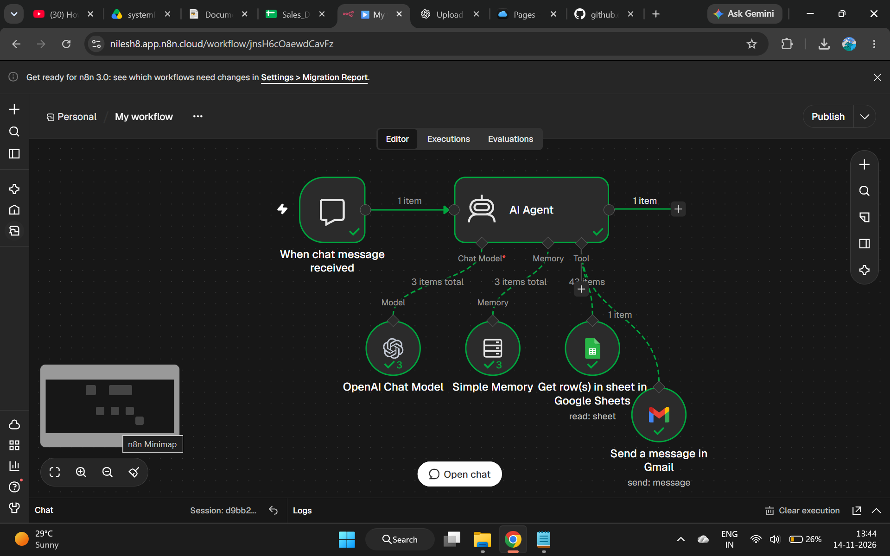
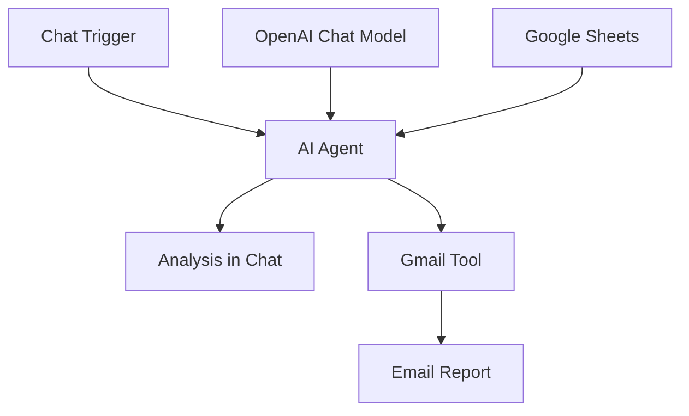

# Sales Data Analyst AI Agent

An AI-powered Sales Data Analyst built using **n8n, OpenAI, Google Sheets and Gmail**. This project enables users to interact with sales data using natural-language questions and receive meaningful, data-driven insights.

---

## Project Overview

The Sales Data Analyst AI Agent automates sales data analysis through an AI-powered workflow.

Users can ask questions about sales performance, customers, products, orders and geographical trends. The AI Agent retrieves relevant records from Google Sheets, processes the requested analysis and generates understandable results.

The workflow also integrates Gmail to send analysis reports through email.

## Project Workflow



*Complete n8n workflow showing the AI Agent and its integrations.*

## Technologies Used

| Technology | Purpose |
|---|---|
| n8n | Workflow automation and AI Agent orchestration |
| OpenAI | Natural-language understanding and AI reasoning |
| Google Sheets | Sales dataset and data retrieval |
| Gmail | Automated email reporting |

## Key Features

- Natural-language interaction with sales data.
- Total sales and average sales calculations.
- Unique customer analysis.
- City-wise and country-wise customer breakdowns.
- Product-line performance analysis.
- Sales trends and performance insights.
- Order and deal-size analysis.
- Automated email reporting through Gmail.
- HTML-formatted analysis reports.

## Workflow Architecture



## How It Works

1. **User Input:** The user submits a sales-related question through the n8n chat interface.
2. **AI Processing:** The AI Agent interprets the user's request.
3. **Data Retrieval:** Google Sheets provides the relevant sales records.
4. **Data Analysis:** The AI Agent processes the retrieved data and generates the requested insights.
5. **Chat Response:** The analysis results are presented to the user.
6. **Email Automation:** Gmail sends the generated report to the configured recipient.

## Dataset Information

The project uses a sales dataset containing the following fields:

- ORDERNUMBER
- QUANTITYORDERED
- PRICEEACH
- SALES
- ORDERDATE
- STATUS
- PRODUCTLINE
- PRODUCTCODE
- CUSTOMERNAME
- CITY
- STATE
- COUNTRY
- TERRITORY
- DEALSIZE

## Example Questions

- What are the total sales?
- Which product line generates the highest revenue?
- How many unique customers are there in each city?
- What is the average order value?
- Which country contributes the most sales?
- Show quarterly sales performance.
- Which products have the highest sales?
- What is the total quantity ordered?

## Project Structure

```text
sales-data-analyst-ai-agent/
│
├── Sales-Data-Analyst-AI-Agent.json
├── Screenshot 2026-11-14 134447.png
└── README.md
```

## How to Import and Run

1. Download the workflow JSON file from this repository.
2. Open your n8n instance.
3. Import the workflow JSON file.
4. Configure your own OpenAI credentials.
5. Connect your Google Sheets account and select the sales dataset.
6. Configure your Gmail credentials.
7. Execute the workflow.
8. Ask questions through the AI Agent chat interface.

## Requirements

- An active n8n instance.
- OpenAI API access.
- Google Sheets account with access to the sales dataset.
- Gmail account with appropriate permissions.

## Important Notes

- Configure your own credentials before executing the workflow.
- The workflow requires access to a compatible sales spreadsheet.
- Email reporting depends on correct Gmail configuration and successful execution.
- Never upload API keys, passwords, OAuth tokens or confidential customer data to a public repository.

## Author

**Nilesh**

GitHub: [neill-dev](https://github.com/neill-dev)

Project Repository: [Sales Data Analyst AI Agent](https://github.com/neill-dev/sales-data-analyst-ai-agent)

---

*Built to explore AI agents, data analysis and intelligent workflow automation using n8n.*
