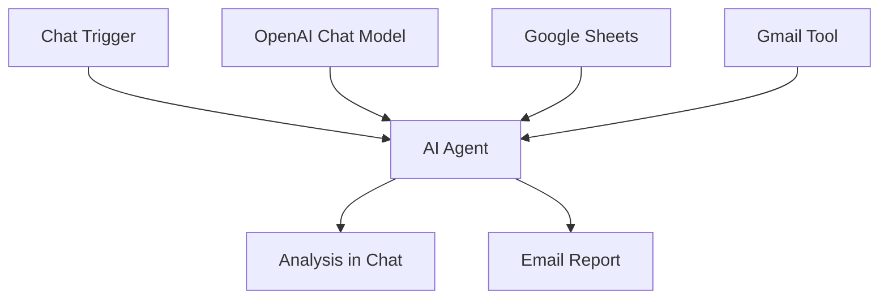

# Sales Data Analyst AI Agent

An AI-powered Sales Data Analyst built using **n8n, OpenAI, Google Sheets and Gmail**. This project allows users to ask sales-related questions in natural language and receive data-driven insights through an AI Agent.

## Project Preview


*End-to-end n8n workflow showing the AI Agent, OpenAI Chat Model, Google Sheets and Gmail integration.*

## Project Overview

The Sales Data Analyst AI Agent automates sales data analysis using natural-language queries. It retrieves records from Google Sheets, processes the requested analysis and generates understandable results.

The agent is designed to email analysis reports to the configured recipient through Gmail.

## Technologies Used

| Technology | Purpose |
|---|---|
| n8n | Workflow automation |
| OpenAI | AI-powered analysis and natural-language understanding |
| Google Sheets | Sales data source |
| Gmail | Automated email reporting |

## Key Features

- Natural-language interaction with sales data.
- Customer analysis and unique customer counts.
- City-wise and country-wise sales analysis.
- Product-line performance analysis.
- Total sales and average sales calculations.
- Identification of sales trends and key findings.
- Automated email reporting through Gmail.
- HTML-formatted analysis reports.

## Workflow Architecture



## How It Works

1. The user submits a sales-related question through the n8n chat interface.
2. The AI Agent understands the user's request.
3. Google Sheets provides the sales records.
4. The AI Agent performs the requested analysis.
5. The results are presented in the chat.
6. The Gmail integration sends the generated report to the configured email address.

## Dataset

The project uses a sales dataset containing fields such as:

- Order Number
- Quantity Ordered
- Price Each
- Sales
- Order Date
- Product Line
- Customer Name
- City
- Country
- Deal Size

## Example Queries

Users can ask questions such as:

- What are the total sales?
- Which product line generates the highest revenue?
- How many unique customers are there in each city?
- What is the average order value?
- Which country contributes the most sales?
- Show quarterly sales performance.

## Project Structure

```text
sales-data-analyst-ai-agent/
│
├── Sales-Data-Analyst-AI-Agent.json
├── README.md
│
└── screenshots/
    ├── workflow.png
    └── email-report.png
```

## How to Import and Run

1. Download the workflow JSON from this repository.
2. Open your n8n instance.
3. Import the downloaded workflow.
4. Configure your own OpenAI, Google Sheets and Gmail credentials.
5. Connect your sales spreadsheet.
6. Execute the workflow and ask questions through the chat interface.

## Important Notes

- You must configure your own API credentials and Google account access.
- The workflow requires access to a compatible Google Sheets sales dataset.
- Email delivery depends on correct Gmail tool configuration.
- Do not share credentials, API keys or private customer information.

## Author

**Nilesh**

GitHub: https://github.com/neill-dev

---

*Built as a practical project exploring AI agents, data analysis and workflow automation.*
